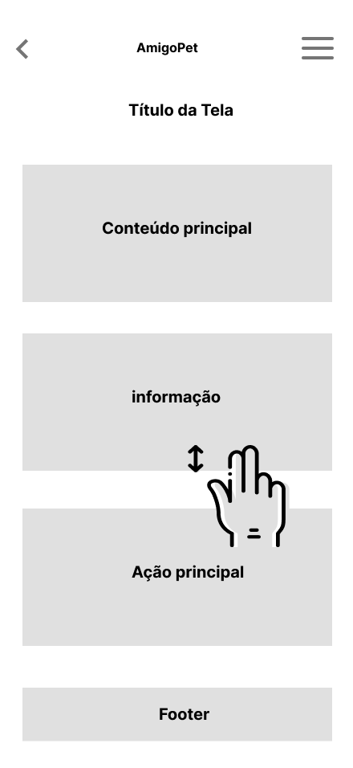

# Template padrão da Aplicação

Layout padrão do site (HTML e CSS) que será utilizado em todas as páginas com a definição de identidade visual, aspectos de responsividade e iconografia.

[Apresente a estrutura padrão da sua aplicação.]

A aplicação AmigoPet terá como foco principal dispositivos móveis, sendo desenvolvida com uma abordagem mobile-first. As telas serão projetadas para facilitar o uso pelo tutor durante todo o processo de busca, escolha e acompanhamento de uma clínica veterinária.

### O padrão visual das telas será composto por:

- **Barra superior:** contendo botão de voltar,menu, título da página e, quando necessário, ícones de ações.
- **Conteúdo principal:** área destinada às informações e funcionalidades da tela.
- **Cards:** utilizados para apresentar clínicas, informações do animal e dados do atendimento.
- **Botões de ação:** posicionados de forma destacada, principalmente na parte inferior da tela.
- **Barra de navegação inferior:** utilizada nas telas principais para acesso rápido às funcionalidades.
- **Ícones:** utilizados para facilitar a identificação das funcionalidades.
- **Mensagens de status:** utilizadas para informar disponibilidade, posição na fila, confirmação e notificações.

### A identidade visual utilizará principalmente:

- **Verde:** ações principais, confirmação e elementos relacionados à saúde;
- **Azul-escuro:** títulos e elementos de destaque;
- **Verde-claro:** cards e áreas informativas;
- **Branco:** fundo principal;
- **Amarelo:** alertas e notificações;
- **Vermelho:** cancelamentos e erros.

### Responsividade

Embora o foco seja mobile, a aplicação deverá possuir uma estrutura responsiva, permitindo sua utilização em diferentes tamanhos de smartphones e, posteriormente, podendo ser adaptada para tablets.

### Estrutura padrão das telas

> **Links Úteis**:
>
> - [CSS Website Layout (W3Schools)](https://www.w3schools.com/css/css_website_layout.asp)
> - [Website Page Layouts](http://www.cellbiol.com/bioinformatics_web_development/chapter-3-your-first-web-page-learning-html-and-css/website-page-layouts/)
> - [Perfect Liquid Layout](https://matthewjamestaylor.com/perfect-liquid-layouts)
> - [How and Why Icons Improve Your Web Design](https://usabilla.com/blog/how-and-why-icons-improve-you-web-design/)
