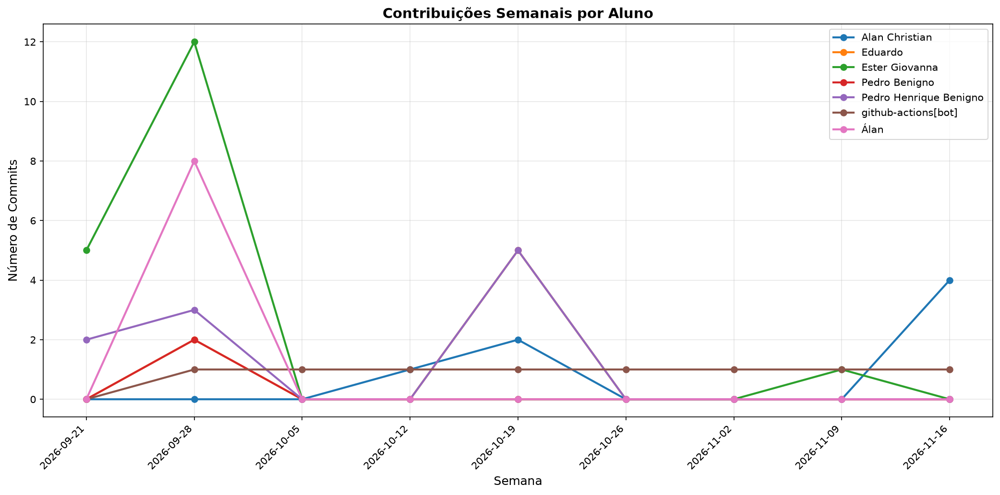

# 📊 Relatório de Contribuições do Projeto

**Última atualização:** 23/11/2026 00:17

---

## 📈 Resumo Geral de Contribuições

| Aluno                  |   Commits |   Linhas+ |   Linhas- |   Arquivos |   Docs Commits |   Docs Arquivos |
|------------------------|-----------|-----------|-----------|------------|----------------|-----------------|
| Alan Christian         |         7 |      7434 |       444 |         70 |              0 |               0 |
| Eduardo                |         7 |       560 |       203 |         27 |              0 |               0 |
| Ester Giovanna         |        18 |      1089 |        53 |         25 |              8 |               1 |
| Pedro Benigno          |         2 |        38 |        10 |          1 |              0 |               0 |
| Pedro Henrique Benigno |        10 |      3189 |       218 |         52 |              1 |               1 |
| github-actions[bot]    |         8 |        86 |        23 |          3 |              8 |               1 |
| Álan                   |         8 |        74 |        31 |         12 |              0 |               0 |

## 📅 Contribuições Semanais (Todo o Semestre)

**2026-11-16**: Alan Christian: 4, github-actions[bot]: 1

**2026-11-09**: Ester Giovanna: 1, github-actions[bot]: 1

**2026-11-02**: github-actions[bot]: 1

**2026-10-26**: github-actions[bot]: 1

**2026-10-19**: Alan Christian: 2, Eduardo: 5, Pedro Henrique Benigno: 5, github-actions[bot]: 1

**2026-10-12**: Alan Christian: 1, github-actions[bot]: 1

**2026-10-05**: github-actions[bot]: 1

**2026-09-28**: Eduardo: 2, Ester Giovanna: 12, Pedro Benigno: 2, Pedro Henrique Benigno: 3, github-actions[bot]: 1, Álan: 8

**2026-09-21**: Ester Giovanna: 5, Pedro Henrique Benigno: 2

## 📊 Visualização Gráfica

## ℹ️ Observações

- **Commits**: Número total de commits realizados

- **Linhas+**: Linhas de código adicionadas

- **Linhas-**: Linhas de código removidas

- **Arquivos**: Número de arquivos únicos modificados

- **Docs Commits**: Commits em arquivos de documentação

- **Docs Arquivos**: Arquivos de documentação modificados

---

*Relatório gerado automaticamente via GitHub Actions*
